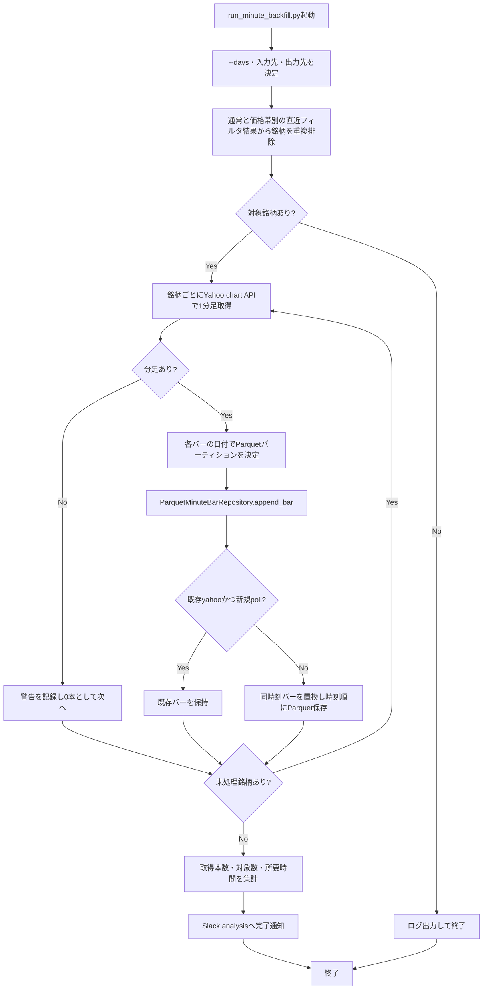

# 詳細設計書 04 分足バックフィル

> 状態: 一部未反映    最終更新: 2026-10-08
> 起動: `run_minute_backfill.py`    関連: [05 バックテスト](./05-backtest-design.md)、[分足データの用途](../../data/minute_bars_parquet/用途_Parquet形式の分足データ.md)

## 1. 概要

直近のフィルタリング結果に登場した銘柄について、Yahoo Financeから1分足を取得し、銘柄・日付単位でParquetに保存します。既存の自前ポーリングデータがあればYahoo由来のデータで補強します。売買判断・注文は本機能の対象外です。

## 2. 実行方式

`run_minute_backfill.py`が直近`--days`日分の通常・価格帯別フィルタリング結果から重複のない銘柄一覧を作り、`MinuteBarBackfillUseCase`を実行します。`--days`の既定値は7日です。現在の`task_schedule.py`は土曜07:30を予定しています。

| 時刻 | 起動主体 | 前後の機能 |
|---|---|---|
| 土曜07:30 | `scripts/tasks/run_minute_backfill.ps1` | バックテスト（08:00）より前 |
| 手動 | `run_minute_backfill.py` | 引数で対象日数・入出力ディレクトリを指定可能 |

リポジトリ内の予定は土曜07:30ですが、エントリポイントの想定運用コメントは毎週月曜です。実際のOSタスク登録状況は確認できていません。

## 3. 入出力

入力する通常および価格帯別のフィルタ結果から銘柄を集め、Yahoo Financeの1分足を銘柄・日付別のParquetパーティションへ保存します。完了した取込結果をSlack `analysis`へ通知します。

| 項目 | 方向 | 場所・形式 | 備考 |
|---|---|---|---|
| 通常フィルタ結果 | 入力 | `FILTERING_RESULT_DIRECTORY` | 日付別JSON |
| 価格帯別フィルタ結果 | 入力 | `FILTERING_PRICE_BAND_RESULT_ROOT/<価格上限>/` | 通常ディレクトリを明示指定した場合は対象外 |
| Yahoo 1分足 | 入力 | Yahoo Finance chart API | `--days`で取得期間を指定 |
| 分足データ | 出力 | `data/minute_bars_parquet/symbol=<銘柄>/date=<日付>/data.parquet` | `MINUTE_BAR_PARQUET_DIR`で変更可能 |
| 日経225の1分足 | 出力 | `data/index_minute_bars_parquet/symbol=^N225/date=<日付>/data.parquet` | `INDEX_MINUTE_BAR_PARQUET_DIR`。本タスクではなく日次分析(引け後)と`run_index_minute_backfill.py`が保存。CAUTION検証用 |
| 取込結果通知 | 出力 | Slack `analysis` | 対象数、取込本数、所要時間 |
| 当日分足(日次取得) | 出力 | 上記と同じ`data/minute_bars_parquet/` | 日次分析(引け後16:30)が当日のフィルタ結果の銘柄を保存。[§11](#11-日次分析での当日分足の保存)参照 |

## 4. 処理フロー

銘柄を重複なく集め、Yahooの分足を日付別Parquetへ保存します。取得できない銘柄は0本として記録し、次の銘柄へ進みます。

この図は現行のentrypoint・usecase・Parquet repositoryの動作を表します。予定表上の土曜07:30と起動コメント上の月曜が一致せず、OSスケジューラ登録状況も確認できません。

## 5. 判断ルール・仕様

同じ銘柄・時刻にデータが重なった場合は、Yahoo由来のデータを優先して保持します。

| 条件 | 結果 |
|---|---|
| 対象銘柄のYahooデータが空 | 警告ログを出し、その銘柄は0本として次へ進む |
| 既存データがYahoo由来で、新しいデータが`poll` | 既存のYahooデータを上書きしない |
| 同一時刻に優先されるYahooデータがある | 既存時刻の足を置換し、時刻順に並べて保存 |
| 新しいバーの保存 | `time[:10]`の日付でパーティションを選ぶ |
| Parquetファイルの置換で`PermissionError` | 最大5回試行し、回数に応じた待ち時間で再試行 |

## 6. レイヤー別の構成

| ファイル | 層 | 役割 |
|---|---|---|
| `src/domain/models.py` | domain | `MinuteBar`データモデル |
| `src/application/minute_bar_backfill_usecase.py` | application | 銘柄ごとの取得、日付別振分け、保存呼び出し |
| `src/infrastructure/market_data/get_intraday_bars.py` | infrastructure | Yahoo Financeの分足取得 |
| `src/infrastructure/persistence/parquet_minute_bar_repository.py` | infrastructure | Parquetパーティションの読込・保存・Yahoo優先処理 |
| `src/entrypoints/run_minute_backfill.py` | entrypoints | 対象銘柄収集、依存構築、処理計測、通知 |

## 7. 異常系・失敗時の動き

| 事象 | 検知方法 | 動き | 通知 | 理由コード |
|---|---|---|---|---|
| 対象銘柄がない | 収集した銘柄数 | ログを出して終了 | なし | なし |
| Yahoo分足が空 | 取得結果が空 | 当該銘柄を0本で記録し、次の銘柄へ進む | 警告ログ | なし |
| Parquet保存に`pyarrow`がない | 遅延import | `RuntimeError`を送出する | `process_notification()`が例外を記録し再送出 | `RuntimeError` |
| Parquet置換が再試行上限後も失敗 | `PermissionError`が継続 | 例外を送出し、以降の処理を中断 | `process_notification()`が例外を記録し再送出 | `PermissionError` |

## 8. 設定項目

共通設定は[config-reference.md](../reference/config-reference.md)を参照してください。起動引数は`--days`（既定7）、`--filtering-dir`、`--output-dir`です。出力先の設定値は`MINUTE_BAR_PARQUET_DIR`です。

## 9. 決定事項と変更履歴

| 日付 | 決定 | 理由 |
|---|---|---|
| 2026-10-08 | 現行の銘柄収集・Yahoo取得・Parquet保存フローを設計図へ反映する | 旧図のJSON保存表記と取得経路が現行コードと異なるため |
| 2026-10-11 | 日経225の1分足は別ディレクトリに保存し、新タスクを増やさず日次分析の引け後に相乗りする | `^N225`を`minute_bars_parquet`に混ぜると分析サンドボックスのsymbol整数列読込が壊れるため。Yahoo 1分足は直近約30日・1回8日以内の制限があり、7日ずつ取得する |

| 2026-10-14 | 当日の対象銘柄の1分足も日次分析(引け後)で保存する(§11) | 分足グラフで当日分を見るため。土曜の取り直しとは同じ保存先・同じ優先ルールで矛盾させない |

## 10. 未決・既知の課題

- OSタスクの登録状況と、予定表（土曜07:30）・エントリポイントコメント（月曜）・旧図（月・木07:30）のどれが運用時刻の正かは要確認。
- `collect_recent_symbols()`は`today - days`以降の日付を含むため、`--days=7`のとき日付境界上は8つの暦日ラベルを対象にします。一方Yahoo APIの`range=7d`は直近7日程度です。対象期間の数え方を一致させるかは要確認。
- `get_yahoo_intraday_bars()`はAPI取得結果をそのまま保存処理へ渡し、バックフィルusecase/repositoryに`latest_confirmed_trading_day()`による確定日フィルタはありません。引け前実行時に当日未確定バーが保存されない保証は要確認。

## 11. 日次分析での当日分足の保存

日次分析(引け後16:30)が、日足更新の後・分析の前に、当日の通常フィルタ結果(`data/filtering/YYYY-MM-DD.json`)の銘柄の1分足を保存します。新しいタスクは作りません。`DAILY_MINUTE_BAR_INCLUDE_PRICE_BANDS=true`(既定false)で価格帯別(450円帯・900円帯)の銘柄も対象にできます。

| 項目 | 内容 |
|---|---|
| 実装 | `src/entrypoints/save_daily_minute_bars.py`(`save_daily_minute_bars`)、`src/application/daily_minute_bar_save_usecase.py` |
| 取得元・保存先 | 土曜バックフィルと同じ(Yahoo 1分足`range=7d`、`symbol=<銘柄>/date=<日付>/data.parquet`)。対象日の足だけ保存 |
| 冪等性 | 既存の足を時刻で統合し、同時刻はYahooの足で置換、Yahooに無い時刻の既存足は残す。何度実行しても重複せず、土曜の取り直しとも同じ結果に収束する |
| 実行条件 | 取引日かつ`latest_confirmed_trading_day(now) >= 対象日`(引け後)。休場日・祝日・引け前・対象銘柄なしは何もしない |
| 失敗時 | 例外を投げない(`save_index_minute_bars`と同じ)。銘柄別に理由(`NO_RESPONSE`、`YAHOO_ERROR:*`、`EMPTY_RESPONSE`、`NO_BARS_FOR_DATE`、`EXCEPTION:*`、`SAVE_ERROR:*`)をログへ残し次の銘柄へ進む |
| 取得間隔・再試行 | 銘柄間0.5秒。失敗・空応答は最大2回再試行(5秒間隔)。10銘柄で約8秒 |
| 本数の扱い | 日次取得では、同じ銘柄の保存済み直近10営業日の本数中央値(少なくとも3日必要。土曜バックフィル分も含む)の50%未満だけを「本数少」と記録する。履歴不足や低出来高による通常の少本数は判定しない |
| 通知 | 異常がなければ`分足 10銘柄すべて保存`。0本・保存失敗・本数少がある場合だけ該当銘柄コードをSlackの1行に出す。専用通知なし |

実績(2026-10-13、引け後に手動実行): 10銘柄すべて保存。日経225の分足は引け後(16:30台)の保存で09:00〜15:30の333本が揃っており、個別銘柄の足も同様に15:24まで取得できた。

土曜バックフィル後の整合確認には`scripts/analysis/compare_daily_vs_backfill_minute_bars.py`(`snapshot`で日次取得直後の本数・価格を保存し、`compare`でバックフィル後と比較)を使います。
