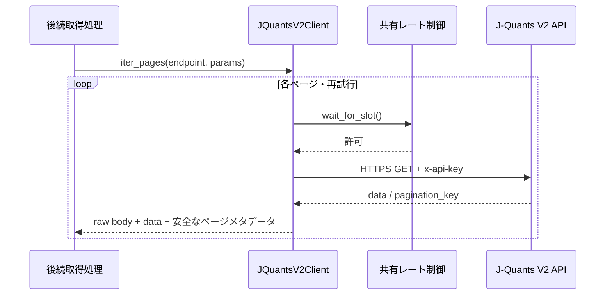
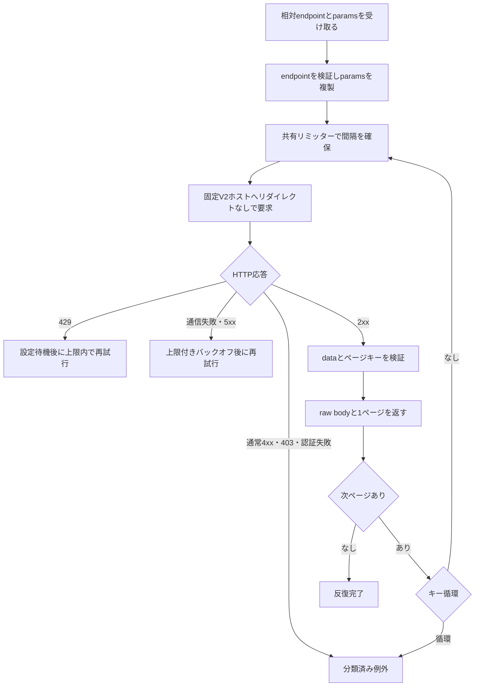

# 詳細設計書 15 J-Quants V2取得クライアント

> 状態: 一部未反映    最終更新: 2026-10-21
> 起動: なし（後続取得処理から利用）    関連: [04 分足バックフィル](./04-minute-bar-backfill-design.md)

## 1. 概要

J-Quants API V2へのページ単位HTTP取得、レート制御、限定的な再試行、安全なエラー分類を提供します。
このPRでは取得クライアントと自動テストだけを実装し、日次全銘柄取得、過去補填、保存、取得台帳、COMPLETE判定は実装しません。
既存のYahoo・kabu・実売買経路と共通HTTP処理は変更しません。
取得raw保存・取得台帳・確定方式は[16 J-Quants raw・取得台帳・確定](./16-jquants-raw-ledger.md)を参照してください。

## 2. 実行方式

単体の起動処理はありません。後続PRが`JQuantsV2Client.iter_pages()`を呼び、ページを順番に消費します。
同じ`JQuantsRateLimiter`を使うクライアントは、単一プロセス内でリクエスト間隔を共有します。

反復を最後まで完了する前に呼び出し側が処理を中断した場合、全ページ取得済みとはみなしません。途中ページの失敗と循環キーは例外になります。

## 3. 入出力

| 項目 | 方向 | 場所・形式 | 備考 |
|---|---|---|---|
| APIキー | 入力 | 明示注入または`JQUANTS_API_KEY` | 未設定時は通信前に設定エラー |
| APIリクエスト | 出力 | 固定HTTPSホスト`api.jquants.com/v2` | 相対パスのみ。自動リダイレクト無効 |
| API応答 | 入力 | V2 JSONの`data`と`pagination_key` | 空の`data`は正常。欠落・型不正は例外 |
| ページ結果 | 出力 | `JQuantsPage` | raw body bytes、未変換data、安全なメタデータ |

## 4. 処理フロー

ページ単位で結果を返し、全件分をクライアント内に蓄積しません。各物理HTTP要求（初回・再試行）は共通リミッターを通ります。

## 5. 判断ルール・仕様

| 条件 | 結果 |
|---|---|
| 正常な`data: []` | 0件ページとして成功 |
| `data`欠落、配列以外、要素がオブジェクト以外 | `JQuantsResponseError` |
| HTTP 401 / 403 / 429 | 認証 / アクセスまたは契約系 / レート制限エラーに分類 |
| HTTP 400等の4xx | `CLIENT_REQUEST_ERROR`。契約範囲外とは断定せず、本文にも依存しない |
| 一時通信失敗・5xx | 最大試行回数内で指数バックオフ |
| 429 | 最大試行回数内で既定120秒待機 |
| 取得ページキーが循環 | `JQuantsPaginationError` |
| API失敗 | None・空配列・一部だけの全件結果には変換しない |
| 接続先・リダイレクト | HTTPS固定ホスト、相対パスのみ、自動追従なし |
| ログ・エラー | APIキー、認証ヘッダー、URL、レスポンス本文、ページキーを含めない |

V2の認証は`x-api-key`、ページ応答の走査は`data`と`pagination_key`を前提にします。J-Quantsの公式仕様ページは実装時にWAFで取得できず、詳細なdaily/minute項目や各エンドポイント固有パラメータは独立確認できていません。そのため本クライアントは相対パスとパラメータを受け取り、未確認の項目を解釈・変換しません。

確認対象は[公式V2日足仕様](https://jpx-jquants.com/en/spec/eq-bars-daily)、[公式V2分足仕様](https://jpx-jquants.com/en/spec/eq-bars-minute)、[公式V2クイックスタート](https://github.com/J-Quants/jquants-api-quick-start/blob/main/jquants-api-quick-start-v2.ipynb)です。API仕様ページはWAFのチャレンジ応答となり、内容を直接確認できませんでした。認証・ページングの基本契約は本実装プロンプトに明記された契約を用いています。

契約範囲外の問い合わせが返すHTTPステータスとエラーコードも独立確認できていません。403はアクセス/契約系として分類しますが、契約範囲外かどうかの最終判定は呼び出し側に委ねます。400等の4xxは要求エラーとして分類し、契約範囲外とは断定しません。生レスポンス本文を調べて推測分類することはしません。

例外とログにAPIキー、認証ヘッダー値、クエリ値、レスポンス本文、ページキーを出しません。HTTPエラーはステータスのみを含み、通信/JSON解析例外は原因連鎖を抑止して安全なメッセージへ変換します。rawレスポンスは後続保存用途としてページオブジェクト内でのみ提供し、reprにも含めません。

Lightプランの確認上限はアカウント単位60リクエスト/分です。既定ペーシングは約1.2秒間隔としますが、同一プロセス以外のプロセスや同一アカウントの別ツールによる要求を制御・保証しません。日次取得と過去補填の並行運用は、プロセス間共有リミッターまたは共有キューを後続PRで導入するまで有効化しません。

ユーザーによる契約境界確認（2026-10-21 JST）:

- 銘柄72030の日足で2021-10-20が範囲外、エラー表示の開始日は2021-10-21。
- 同銘柄の分足で2024-10-18が範囲外、エラー表示の開始日は2024-10-21。
- 開始日当日のレコード取得は未実施。これらは確認時点の契約境界であり、レコード存在・全銘柄網羅・保存完了の証明ではありません。恒久的なコード定数にはしません。

## 6. レイヤー別の構成

| ファイル | 層 | 役割 |
|---|---|---|
| `src/config/config.py` | config | APIキー、固定接続先、タイムアウト、試行・ペーシング設定 |
| `src/infrastructure/market_data/jquants_v2_client.py` | infrastructure | HTTP、ページング、レート制御、再試行、エラー分類 |
| `tests/test_jquants_v2_client.py` | tests | 合成レスポンスと差替え可能な時計・sleep・transportによる自動テスト |

## 7. 異常系・失敗時の動き

| 事象 | 検知方法 | 動き | 通知 | 理由コード |
|---|---|---|---|---|
| キー未設定 | クライアント初期化 | 通信せず設定例外 | 呼び出し側 | `JQuantsConfigurationError` |
| 認証・契約エラー | HTTP 401/403 | 再試行せず分類例外 | 呼び出し側 | 専用例外型 |
| 429 / 5xx / 通信失敗 | ステータス・transport例外 | 制限付き再試行後に例外 | 呼び出し側 | 専用例外型 |
| JSON/data不正 | 応答形式検証 | 正常0件にせず形式例外 | 呼び出し側 | `JQuantsResponseError` |
| 次ページ失敗・キー循環 | ページ取得 | 例外を伝播し、全件成功を返さない | 呼び出し側 | 専用例外型 |

## 8. 設定項目

`JQUANTS_API_KEY`は`.env`または環境変数から与えます。APIキーをコード、ログ、テストデータへ記載しません。

| 名前 | 意味 | 既定値 |
|---|---|---|
| `JQUANTS_API_BASE_URL` | 固定V2ホスト | `https://api.jquants.com/v2`（環境変数で上書き不可） |
| `JQUANTS_TIMEOUT_SECONDS` | 1要求のタイムアウト | 30秒 |
| `JQUANTS_MAX_ATTEMPTS` | 1ページ要求の総試行回数 | 4 |
| `JQUANTS_REQUEST_INTERVAL_SECONDS` | 同一プロセス内の最小要求間隔 | 1.2秒 |
| `JQUANTS_429_WAIT_SECONDS` | 429後の待機 | 120秒 |
| `JQUANTS_RETRY_BASE_SECONDS` | 一時失敗のバックオフ初期待機 | 1秒 |
| `JQUANTS_RETRY_MAX_SECONDS` | バックオフ上限 | 30秒 |

## 9. 決定事項と変更履歴

| 日付 | 決定 | 理由 |
|---|---|---|
| 2026-10-21 | 既存共通HTTP処理と分離 | 失敗時に`None`を返し、本文をログに含み得るため |
| 2026-10-21 | ページ単位で返し、完了状態を持たない | 部分取得を全件成功と誤認させないため |
| 2026-10-21 | 呼び出しパラメータ・時計・sleep・transportを差替え可能にする | 実API通信・実待機を使わない自動テストのため |

## 10. 未決・既知の課題

- 正式なdaily/minute項目、パラメータ、提供時刻、CSV/Bulk、時刻・調整仕様は公式ページで確認できていません。
- 日次/過去補填の全銘柄対象、上場廃止銘柄、保存・公開・共有条件は未確認です。有料データの公開は保留です。
- raw保存、取得台帳、品質検証、COMPLETE状態、スケジュール、プロセス間レート制御は後続PRの対象です。
- 取得開始日当日のレコード存在は未確認です。ユーザーの境界確認結果から開始日のデータ存在を推定しません。
