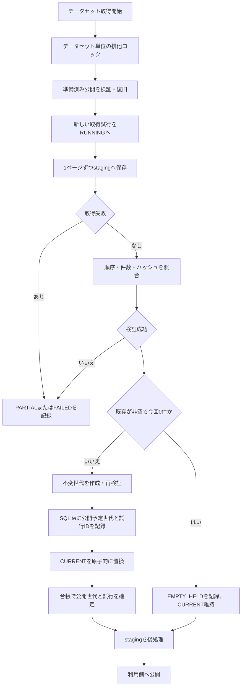
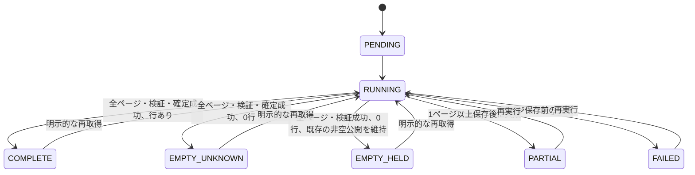

# 詳細設計書 16 J-Quants raw・取得台帳・確定

> 状態: 一部未反映    最終更新: 2026-10-21
> 起動: なし（次PRの取得処理から利用）    関連: [15 J-Quants V2取得クライアント](./15-jquants-v2-client.md)

## 1. 概要

PR2はJ-Quants V2ページ取得結果をrawとして保存し、SQLite台帳で取得試行と最後に確定した世代を別々に管理します。検証済み世代をCURRENTで公開します。
PR2単体では日次全銘柄ジョブ、過去補填、canonical Parquet、バックテスト接続は実装しません。
後続の[PR3単日取得・canonical](./17-jquants-single-day-ingestion.md)は既存の公開・復旧処理を利用します。
契約境界日をコードへ固定せず、既存Yahoo/kabu/売買経路も変更しません。

## 2. 実行方式

次PRの取得処理が`JQuantsRawStore.capture()`へ既存V2クライアントとデータ種別・相対endpoint・安全な検索条件を渡します。
取得処理の全ページが成功し、rawと台帳のページ順序・件数・ハッシュが一致してから世代を公開します。

`datasets.state`は最新の取得試行状態であり、`published_generation_id`は最後に確定した世代です。取得開始・失敗・空置換保留は後者を消しません。全試行の結果とページ進捗は`dataset_attempts`/`dataset_pages`に残します。SQLiteとファイルシステムは一体の原子トランザクションではありません。

公開順序は「不変世代を準備・全件検証 → 公開予定の世代ID/試行IDをSQLiteへ記録 → CURRENT切替 → 台帳の公開世代を確定 → staging削除」です。各段階は同じデータセットロック内で実行します。途中停止後の次回取得または`recover_dataset()`は予定世代を再検証して同じ順序を完了します。確定後のstaging削除失敗は警告結果として記録し、公開状態を戻しません。

## 3. 入出力

| 項目 | 方向 | 場所・形式 | 備考 |
|---|---|---|---|
| 受信ページ | 入力 | `JQuantsPage` | クライアントが返す未変換`data`とrawレスポンス |
| staging | 出力 | `data/jquants/raw/staging/<dataset_id>/<run_id>/pages.jsonl` | ページごとに耐久書込み。失敗時は残す |
| committed | 出力 | `data/jquants/raw/committed/<dataset_id>/generations/<content_hash>/` | immutableな`pages.jsonl`と`manifest.json` |
| 公開ポインタ | 出力 | `.../committed/<dataset_id>/CURRENT` | temp fileから`os.replace`で原子的に更新 |
| 取得台帳 | 入出力 | `data/jquants/ledger.sqlite3` | dataset状態とpageごとの件数/status/hash |
| 取得試行 | 入出力 | SQLite `dataset_attempts` | 試行IDごとの状態、ページ数、行数、エラー/後処理警告 |
| 公開準備 | 入出力 | SQLite `pending_publications` | CURRENT切替前に試行ID・予定世代ID・状態・件数/hashを永続化 |
| 排他ロック | 入出力 | `data/jquants/raw/locks/<dataset_id>.lock` | Windowsのプロセス間ファイルロック |

保存するページJSONLはresponse内の未変換`data`と安全な取得メタデータです。元レスポンスから`pagination_key`をコピーせず、キー・ヘッダー・URL・例外本文も保存しません。dataレコードのフィールド/値自体は変更せず、`{"data": [...]}`の安全な包みにして再変換に利用します。

## 4. 状態遷移

`COMPLETE`は空でないデータセットのみを表します。初回など公開世代がない場合、全ページ取得・検証済みで行数0なら`EMPTY_UNKNOWN`とし、無取引・休場・未提供などの意味を推測しません。既存公開世代が非空の再取得で0件だった場合は`EMPTY_HELD`を記録し、取得成功・0件という事実を保持しながらCURRENTを変更しません。通信失敗は`PARTIAL`/`FAILED`であり、空取得とは区別します。

実装上は取得開始と同じSQLiteトランザクション内で`RUNNING`を予約します。`PENDING`は将来のキュー投入用状態として予約し、このPRのcapture経路では作成しません。

## 5. 判断ルール・仕様

| 条件 | 結果 |
|---|---|
| データ種別 | `daily`または`minute`のみ |
| request conditions | `date`, `from`, `to`, `code`のみ。APIキー/ページキー/任意クエリは拒否 |
| ページ順序 | 1からの連番でない場合は検証失敗 |
| ページ内容 | `data`欠落/不整合、ページ件数/status不整合、raw hash不一致で検証失敗 |
| 同じ非空ページhash | 重複ページとして検証失敗 |
| 途中失敗 | 保存済みpageがあれば`PARTIAL`、なければ`FAILED` |
| 公開世代がない状態で0件 | 全ページ正常・検証・確定後に`EMPTY_UNKNOWN` |
| 非空公開後の正常0件 | `EMPTY_HELD`と試行件数を記録し、最後の非空公開世代とCURRENTを維持 |
| 同一内容の再確定 | content hashで同じgenerationを再利用し、レコードを重複追加しない |
| staging/台帳不一致 | 公開せず`PARTIAL`または`FAILED` |

`CURRENT`は公開先を指すファイルですが、それ単独では信用しません。台帳の`published_generation_id`を最後の確定世代として扱い、manifest・pages.jsonl・各ページhash・ページ順/件数・再計算した世代hashを検証します。取得試行が`RUNNING`/`PARTIAL`/`FAILED`/`EMPTY_HELD`でも検証済みの旧公開世代を読めます。CURRENTと台帳が異なる場合は、記録済みのpending世代と一致する公開途中だけ旧世代を返し、それ以外は明確な不整合として停止します。復旧時はpendingを完全検証してから公開を完了し、pendingが不正なら検証済み旧世代へCURRENTを戻すか、安全側に停止します。

公開確定後のstaging削除は後処理です。失敗は`STAGING_CLEANUP_FAILED`として結果・台帳・秘匿ログに記録します。世代hashはページデータのhash列をページ順に連結した取得表現の同一性であり、取得時刻は含みません。一方、ページ分割・ページ順・各ページ内の行順が異なると、同じ行集合でも別世代になり得ます。全件ソートによる集合hashは今回導入しません。

## 6. レイヤー別の構成

| ファイル | 層 | 役割 |
|---|---|---|
| `src/config/config.py` | config | rawディレクトリとSQLite台帳の保存先 |
| `src/infrastructure/market_data/jquants_v2_client.py` | infrastructure | V2 APIページ取得 |
| `src/infrastructure/market_data/jquants_raw_store.py` | infrastructure | raw/staging、SQLite台帳、検証、世代公開 |
| `tests/test_jquants_raw_store.py` | tests | 合成ページによる保存・状態・ロック・再実行テスト |

## 7. 異常系・失敗時の動き

| 事象 | 検知方法 | 動き | 通知 | 理由コード |
|---|---|---|---|---|
| 二重起動 | OSロック取得失敗 | 取得開始前に拒否 | 呼び出し側 | `JQuantsDatasetAlreadyRunningError` |
| 途中ページ/検証失敗 | iterator例外・不整合検証 | stagingを保持し`PARTIAL`/`FAILED` | 呼び出し側 | 安全なcategory |
| プロセス異常終了 | pending記録とCURRENTを照合 | ロック解放後の次回取得/`recover_dataset()`が予定世代を検証して公開を完了 | 運用 | `RUNNING`/pending |
| CURRENT更新・台帳確定の途中失敗 | pending記録・CURRENT・世代hash | 旧世代を読める状態を保ち、次回復旧で予定世代を検証。整合しない場合は旧世代復元または安全停止 | 呼び出し側 | `RUNNING`/pending |
| staging後処理失敗 | `shutil.rmtree`のOS例外 | 公開確定を維持し、警告を結果・台帳・秘匿ログへ記録 | 呼び出し側 | `STAGING_CLEANUP_FAILED` |
| API/OS例外 | 例外型/category | 生メッセージを出さず安全な例外とcategoryを台帳保存 | 呼び出し側 | 固定category |

## 8. 設定項目

| 名前 | 意味 | 既定値 |
|---|---|---|
| `JQUANTS_RAW_DIRECTORY` | raw/staging/committed/lockのルート | `data/jquants/raw` |
| `JQUANTS_LEDGER_DATABASE_FILE` | SQLite取得台帳 | `data/jquants/ledger.sqlite3` |

パスは`Path.resolve()`で絶対化し、Windowsの`normcase`を適用したrawルートを台帳に関連付けます。同一SQLite台帳を異なるrawルートで開く設定は拒否します。通常のローカルWindowsファイルシステムを対象とし、ネットワークドライブ等のロック保証はしていません。Windows専用のraw-storeテストは非Windowsでskipし、そのskipはWindows上のテスト実行の代替ではありません。非対応OSでは保存先やDBに触れる前に明示エラーとなります。

通常のプロセス停止では、永続化済みpending記録とOSロック解放後の再実行で公開を回復します。ファイル内容の`fsync`は行いますが、SQLiteとCURRENTを跨ぐ電源断耐性や、ファイルシステム/ストレージ装置ごとの永続化順序までは保証しません。

既存台帳は列追加と試行履歴表の作成で移行し、既存状態・ページ記録・raw世代を削除しません。既存CURRENTは世代全体のhash検証に成功した場合だけ台帳の公開世代として取り込みます。不正/欠落世代は自動で選び直さず、不整合として扱います。

## 9. 決定事項と変更履歴

| 日付 | 決定 | 理由 |
|---|---|---|
| 2026-10-21 | SQLiteとページ別進捗を使用 | 状態更新・二重起動予約の耐久性 |
| 2026-10-21 | データ世代を不変保存し`CURRENT`を切替 | 非空ディレクトリ置換に依存せず公開ポインタを原子的に更新 |
| 2026-10-21 | raw envelopeからページキーを除外 | 認証情報・不透明なページトークンを保存しない |
| 2026-10-21 | 取得試行と最後の確定世代を分離 | 再取得中/失敗時に旧公開世代を維持 |
| 2026-10-21 | pending公開記録と検証付き復旧を導入 | SQLiteとCURRENTの停止点ごとの不整合を回復 |
| 2026-10-21 | 非空公開に対する正常0件を`EMPTY_HELD`にする | 空結果による既定の公開置換を防止 |

## 10. 未決・既知の課題

- 日足/分足の正確なAPI項目・endpoint/parameter契約は公式仕様のWAF制限により未確認です。captureは呼び出し側から相対endpointを受け、未確認のAPI項目を決めません。
- `EMPTY_UNKNOWN`/`EMPTY_HELD`は空応答の観測を記録するだけで、無取引・休場・提供対象外・欠損の判断はしません。
- 全銘柄日次取得、過去補填、プロセス間API共有レートキュー、canonical Parquet、品質判定、バックテスト接続は後続PRです。
- 台帳を消失してrawファイルだけ残った場合の自動台帳再構築、staging世代の長期保管/削除方針は未実装です。
- 有料データの公開・共有条件および上場廃止銘柄の網羅性は未確認のため公開を保留します。
