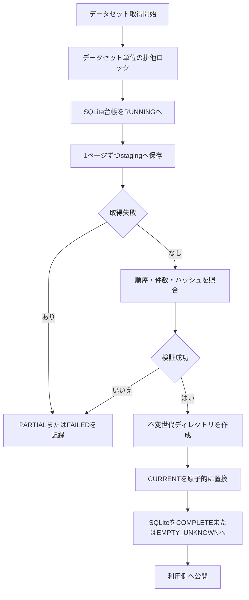
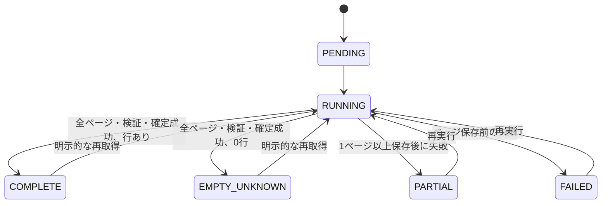

# 詳細設計書 16 J-Quants raw・取得台帳・確定

> 状態: 一部未反映    最終更新: 2026-10-21
> 起動: なし（次PRの取得処理から利用）    関連: [15 J-Quants V2取得クライアント](./15-jquants-v2-client.md)

## 1. 概要

PR2はJ-Quants V2ページ取得結果をrawとして保存し、SQLite台帳でデータセット/page進捗を管理し、検証済み世代を原子的に公開します。
日次全銘柄ジョブ、過去補填、canonical Parquet、バックテスト接続は実装しません。
契約境界日をコードへ固定せず、既存Yahoo/kabu/売買経路も変更しません。

## 2. 実行方式

次PRの取得処理が`JQuantsRawStore.capture()`へ既存V2クライアントとデータ種別・相対endpoint・安全な検索条件を渡します。
取得処理の全ページが成功し、rawと台帳のページ順序・件数・ハッシュが一致してから世代を公開します。

SQLiteのRUNNING予約とOSファイルロックの両方で同一データセットの同時起動を防ぎます。プロセス異常終了後はOSロックが解放され、RUNNINGは台帳で未完了として識別され、再実行で新しいrunとして回収できます。

## 3. 入出力

| 項目 | 方向 | 場所・形式 | 備考 |
|---|---|---|---|
| 受信ページ | 入力 | `JQuantsPage` | クライアントが返す未変換`data`とrawレスポンス |
| staging | 出力 | `data/jquants/raw/staging/<dataset_id>/<run_id>/pages.jsonl` | ページごとに耐久書込み。失敗時は残す |
| committed | 出力 | `data/jquants/raw/committed/<dataset_id>/generations/<content_hash>/` | immutableな`pages.jsonl`と`manifest.json` |
| 公開ポインタ | 出力 | `.../committed/<dataset_id>/CURRENT` | temp fileから`os.replace`で原子的に更新 |
| 取得台帳 | 入出力 | `data/jquants/ledger.sqlite3` | dataset状態とpageごとの件数/status/hash |
| 排他ロック | 入出力 | `data/jquants/raw/locks/<dataset_id>.lock` | Windowsのプロセス間ファイルロック |

保存するページJSONLはresponse内の未変換`data`と安全な取得メタデータです。元レスポンスから`pagination_key`をコピーせず、キー・ヘッダー・URL・例外本文も保存しません。dataレコードのフィールド/値自体は変更せず、`{"data": [...]}`の安全な包みにして再変換に利用します。

## 4. 状態遷移

`COMPLETE`は空でないデータセットのみを表します。全ページを取得し検証・raw確定済みでも、行数0の場合は`EMPTY_UNKNOWN`とし、無取引・休場・未提供などの意味を推測しません。

実装上は取得開始と同じSQLiteトランザクション内で`RUNNING`を予約します。`PENDING`は将来のキュー投入用状態として予約し、このPRのcapture経路では作成しません。

## 5. 判断ルール・仕様

| 条件 | 結果 |
|---|---|
| データ種別 | `daily`または`minute`のみ |
| request conditions | `date`, `from`, `to`, `code`のみ。APIキー/ページキー/任意クエリは拒否 |
| ページ順序 | 1からの連番でない場合は検証失敗 |
| ページ内容 | `data`欠落/不整合、ページ件数/status不整合、raw hash不一致で検証失敗 |
| 同じ非空ページhash | 重複ページとして検証失敗 |
| 途中失敗 | 保存済みpageがあれば`PARTIAL`、なければ`FAILED` |
| 0件 | 全ページ正常・検証・確定後に`EMPTY_UNKNOWN` |
| 同一内容の再確定 | content hashで同じgenerationを再利用し、レコードを重複追加しない |
| staging/台帳不一致 | 公開せず`PARTIAL`または`FAILED` |

`CURRENT`はデータセット内の世代を指す短いポインタです。世代ディレクトリを先に作り、ポインタを原子的に置換し、その後台帳を確定状態にします。利用側は台帳状態が`COMPLETE`/`EMPTY_UNKNOWN`で、ポインタとマニフェストが有効な場合に限り読めます。ファイルシステムとSQLiteをまたぐ単一トランザクションはないため、ポインタ更新後に台帳更新が失敗した場合は未完了状態として隠し、再実行で同一世代を検証して確定します。

## 6. レイヤー別の構成

| ファイル | 層 | 役割 |
|---|---|---|
| `src/config/config.py` | config | rawディレクトリとSQLite台帳の保存先 |
| `src/infrastructure/market_data/jquants_v2_client.py` | infrastructure | V2 APIページ取得 |
| `src/infrastructure/market_data/jquants_raw_store.py` | infrastructure | raw/staging、SQLite台帳、検証、世代公開 |
| `tests/test_jquants_raw_store.py` | tests | 合成ページによる保存・状態・ロック・再実行テスト |

## 7. 異常系・失敗時の動き

| 事象 | 検知方法 | 動き | 通知 | 理由コード |
|---|---|---|---|---|
| 二重起動 | OSロック取得失敗 | 取得開始前に拒否 | 呼び出し側 | `JQuantsDatasetAlreadyRunningError` |
| 途中ページ/検証失敗 | iterator例外・不整合検証 | stagingを保持し`PARTIAL`/`FAILED` | 呼び出し側 | 安全なcategory |
| プロセス異常終了 | 再起動後の台帳照会 | RUNNINGを未完了一覧に表示。ロック解放後に再取得可能 | 運用 | `RUNNING` |
| 確定ポインタ更新失敗 | ファイル置換エラー | 台帳を未完了のまま保持し、利用側へ公開しない | 呼び出し側 | `PARTIAL` |
| API/OS例外 | 例外型/category | 生メッセージを出さず安全な例外とcategoryを台帳保存 | 呼び出し側 | 固定category |

## 8. 設定項目

| 名前 | 意味 | 既定値 |
|---|---|---|
| `JQUANTS_RAW_DIRECTORY` | raw/staging/committed/lockのルート | `data/jquants/raw` |
| `JQUANTS_LEDGER_DATABASE_FILE` | SQLite取得台帳 | `data/jquants/ledger.sqlite3` |

## 9. 決定事項と変更履歴

| 日付 | 決定 | 理由 |
|---|---|---|
| 2026-10-21 | SQLiteとページ別進捗を使用 | 状態更新・二重起動予約の耐久性 |
| 2026-10-21 | データ世代を不変保存し`CURRENT`を切替 | 非空ディレクトリ置換に依存せず公開ポインタを原子的に更新 |
| 2026-10-21 | raw envelopeからページキーを除外 | 認証情報・不透明なページトークンを保存しない |

## 10. 未決・既知の課題

- 日足/分足の正確なAPI項目・endpoint/parameter契約は公式仕様のWAF制限により未確認です。captureは呼び出し側から相対endpointを受け、未確認のAPI項目を決めません。
- `EMPTY_UNKNOWN`は空応答の観測を記録するだけで、無取引・休場・提供対象外・欠損の判断はしません。
- 全銘柄日次取得、過去補填、プロセス間API共有レートキュー、canonical Parquet、品質判定、バックテスト接続は後続PRです。
- 台帳を消失してrawファイルだけ残った場合の自動台帳再構築、staging世代の長期保管/削除方針は未実装です。
- 有料データの公開・共有条件および上場廃止銘柄の網羅性は未確認のため公開を保留します。
