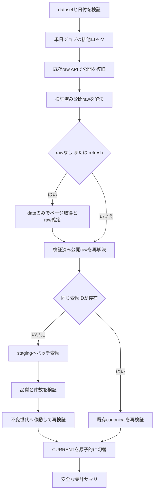

# 詳細設計書 17 J-Quants 指定日の全銘柄取得とcanonical Parquet

> 状態: 一部未反映（実装・モック検証済み、公式仕様の細部と実APIは未検証）
> 最終更新: 2026-10-23
> 起動: `ingest_jquants_single_day.py`
> 関連: [V2クライアント](./15-jquants-v2-client.md)、[raw・台帳](./16-jquants-raw-ledger.md)

## 1. 概要

日次更新・過去補填が共用できる、1日分の全銘柄取得とcanonical変換を実装する。
取得要求は`date`のみとし、現在マスタ・フィルタ結果を使わない。
既存Yahoo/自前Parquet、MinuteBar、バックテスト、公開レポートには接続しない。
本変更では合成データと一時領域で検証し、実APIの取得は行っていない。

## 2. 実行方式

Windowsでリポジトリルートから実行する。以下は利用例であり、今回実行していない。

```powershell
py -m src.entrypoints.ingest_jquants_single_day --dataset daily --date 2026-10-20
py -m src.entrypoints.ingest_jquants_single_day --dataset minute --date 2026-10-20 --refresh
py -m src.entrypoints.ingest_jquants_single_day --dataset daily --date 2026-10-20 --canonical-only
```

- 通常は確定rawを再利用する。rawがなければ遅延生成した既存V2クライアントで取得する。
- `--refresh`は明示再取得、`--canonical-only`はrawなしなら失敗し、通信もクライアント生成もしない。
- 両フラグの同時指定は禁止。日付は実在する`YYYY-MM-DD`のみ。
- 営業日判定で入力日を置き換えない。空結果の原因は推測しない。
- APIキーの引数は存在しない。通常の既存設定経路からクライアントに渡す。
- 終了コードは正常`0`、要確認`2`、取得・変換・保存失敗`1`。
  argparseの入力エラーも既存の慣例に従い`2`で、JSONサマリを出す前に終了する。

## 3. 入出力

rawは既存ストアの検証済み公開世代を解決して読み、canonicalは全銘柄を日付単位に保存する。

| 項目 | 方向 | 場所・形式 | 備考 |
|---|---|---|---|
| raw | 入力/出力 | 既存rawストア・SQLite台帳 | rawの公開プロトコルは変更しない |
| canonical世代 | 出力 | `data/jquants/canonical/<daily,minute>/date=YYYY-MM-DD/generations/<id>/` | Parquetとmanifest |
| Parquet | 出力 | `part-00000.parquet` | 全銘柄、固定schema、Zstandard圧縮 |
| 公開ポインタ | 出力 | 日付partitionの`CURRENT` | 完全検証後に原子的に置換 |
| 変換試行 | 出力 | 日付partitionの`ATTEMPT.json` | `RUNNING` / `FAILED` / `VALIDATED` |
| 実行サマリ | 出力 | 標準出力のJSON | 集計・世代・警告・安全なエラー分類のみ |

manifestはraw世代ID/content hash、schema/transformer版、UTC生成時刻、
行数・銘柄数・品質結果、未対応フィールド名、Parquetのhashとサイズを保持する。
未対応フィールドの**値**はrawだけに残す。CLIにはフィールド名も値も出さず件数のみ出す。
サマリのサイズはrawの`pages.jsonl`とParquet本体のバイト数で、manifest等は含まない。
ページ数・行数は変換入力である公開世代の集計であり、EMPTY_HELDの空試行の件数ではない。
失敗時に出力行数が0でも、rawの状態・世代と品質の`input_rows`は別情報である。

## 4. 処理フロー



ジョブ全体は既存Windowsロック実装を別名前空間のIDで再利用して直列化する。
raw capture/recoveryの既存データセットロックはそのままで、ネスト取得しない。
稼働中のraw captureにはrecoveryがロック取得に失敗して停止し、処理を奪わない。
同一rawストアを使う単日ジョブ同士の二重取得とcanonical公開競合を防ぐ。
低層`capture()`の直接呼出しは従来通り明示取得であり、ジョブ全体ロックには参加しないが、
capture自体の排他は維持する。読み出しは選択済みの不変世代に固定される。
canonicalストアを直接使う場合も`ingestion_lock()`内で呼ぶこと。

## 5. 判断ルール・仕様

### 5.1 固定schema v1

API名をそのまま列名に使用し、推測した別名・型の自動吸収は行わない。
以下はプロンプトを実装契約とした厳格なschemaであり、公式ページで独立確認済みという意味ではない。

| 列 | Arrow型 | null | 検証・精度 |
|---|---|---|---|
| `Code` | string | 不可 | 4〜5文字の英数字。先頭0・英字・現在マスタにないコードを保持 |
| `Date` | date32 | 不可 | 対象日と完全一致 |
| minuteの`Time` | timestamp(us, Asia/Tokyo) | 不可 | `HH:MM`を対象日のJST区間開始時刻へ。秒・丸め・補完なし |
| `O,H,L,C,Vo,Va` | float64 | 可 | 有限で0以上。bool・文字列は不可。0とnullを区別 |
| dailyの`AdjFactor,AdjO,AdjH,AdjL,AdjC,AdjVo` | float64 | 可 | 調整係数が非nullなら正数。調整済みOHLC等は提供値を保持 |
| dailyの`UL,LL` | int8 | 可 | 非nullなら整数の0/1。bool・文字列は不可 |

**上記列のキーは全て必須**。明示的なJSON nullのみをnullとして保持し、
キー欠落をNoneに置き換えない。全列nullの数値列、空データでも列型は固定する。
float64はAPI数値のIEEE 754倍精度表現であり、十進固定小数の完全一致や
2^53超整数の完全精度は保証しない。厳密な取得値はrawに保存する。
分足の株式分割調整・欠落バー補完・特徴量計算は行わない。

### 5.2 品質検査

- 全ページの必須キー・型・日時・対象日・有限数・非負値を検証する。
- 調整前/後それぞれ、非null値について`Low <= O/H/L/C <= High`を検証する。
  比較可能な値のみ検査し、nullを0に変換しない。
- dailyは`Code+Date`、minuteは`Code+Date+Time`を一意キーとする。
- キーごとにrawレコード全体の正規化JSONのSHA-256を記録する。
  完全一致重複と競合重複を別々に数え、**どちらも公開不可**とする。
  未対応フィールドだけ異なる同一キーも競合であり、last-write-winsにしない。
- raw件数、変換入力件数、Parquet件数を照合する。
- 型違反・OHLC異常・重複等があればqualityを試行記録とサマリに残し、新版を公開しない。
- rawは確定済みのまま残るので、修正したtransformer版で通信なしに再変換できる。

### 5.3 公開世代・冪等性

rawは`resolve_published()`を使い、その内部で既存の`get_current_manifest()`による
published_generation_id、CURRENT、manifest、全ページhashの照合を行う。
アプリケーションはCURRENTやDB列からraw世代を独自選択しない。
解決後は`iter_pages()`でページ単位に読み、ページhashと最終件数を再照合する。

canonical IDはdataset、日付、raw世代/hash、schema版、transformer版のhashである。
同一IDはParquet hash・schema・件数・品質・来歴を再検証して再利用し、生成時刻も変えない。
変換コードを変更したら`TRANSFORMER_VERSION`、schemaを変更したら`SCHEMA_VERSION`を更新する。
旧世代は削除せず、CURRENTを読むことで有効版を特定する（全generationsをglobしない）。

canonicalの試行状態と公開状態は別である。`VALIDATED`はCURRENT切替直前に記録するため、
それだけで公開済みとは判定しない。検証済みCURRENTが指す世代が確定版である。
Parquetとmanifestを書込み・fsyncし、不変世代を再検証した後でCURRENTを書込み・fsync・置換する。
変換中の停止では旧CURRENTを維持する。世代準備後の停止は再実行で既存世代を再検証して切替可能。
切替直後の障害でも旧世代のファイルは残り、新CURRENTも完全検証済みである。
同じ入力で再実行すれば回復できる。SQLiteとcanonicalを一体のトランザクションにはしない。
通常の例外ではstagingを削除するが、プロセス強制停止の残骸は自動掃除しない。

### 5.4 空結果と失敗

| 条件 | raw | canonical・サマリ |
|---|---|---|
| 初回の正常0件 | EMPTY_UNKNOWN | 固定schemaの空Parquet。要確認、原因不明 |
| 非空公開後の正常0件 | EMPTY_HELD | 以前の公開rawから変換/再利用。更新報告しない、旧世代利用を明示 |
| 通信失敗 | FAILED/PARTIAL | 今回は変換しない。旧raw/canonical世代を保持し失敗と警告を返す |
| 失敗後の既存raw再利用 | 最新試行FAILED/PARTIAL等 | 旧公開世代である旨を明示して要確認。通信しない |
| raw/CURRENT不整合 | 明示的な検証エラー | 取得による上書きも変換継続もせず失敗 |

`list_attention_datasets()`でEMPTY_UNKNOWN/EMPTY_HELDを参照できる。
`list_incomplete_datasets()`は従来通りPENDING/RUNNING/PARTIAL/FAILEDのみ。
EMPTY_HELDの今回取得hashを公開hashとして使用しない。

## 6. レイヤー別の構成

| ファイル | 層 | 役割 |
|---|---|---|
| [ingest_jquants_single_day.py](../../src/entrypoints/ingest_jquants_single_day.py) | entrypoints | 引数・安全なJSON・終了コード |
| [jquants_single_day_ingestion.py](../../src/application/jquants_single_day_ingestion.py) | application | 復旧・raw取得/再利用・変換・サマリ |
| [jquants_raw_store.py](../../src/infrastructure/market_data/jquants_raw_store.py) | infrastructure | 既存公開APIを使う検証済みページ読み出し、ジョブロック、要確認一覧を追加 |
| [jquants_canonical_store.py](../../src/infrastructure/market_data/jquants_canonical_store.py) | infrastructure | 固定schema、品質検査、世代単位Parquet確定 |
| [test_jquants_single_day_ingestion.py](../../tests/test_jquants_single_day_ingestion.py) | tests | 一時領域・合成データのみの統合/CLI検証 |

## 7. 異常系・失敗時の動き

ログやサマリにはレコード、APIキー、ページキー、例外本文を出さない。
品質不合格は`QUALITY_ERROR`、変換/公開失敗は`CANONICAL_ERROR`、
raw/APIは既存の分類を引き継ぎ、低層保存・形式エラーは`STORAGE_OR_FORMAT_ERROR`とする。
失敗もJSONの`status=FAILED`と非0終了で明示する。
サマリの`previous_canonical_generation_id`は開始時の確定版で、
公開エラー時はCURRENTを再検証して`canonical_generation_id`を実際の有効版に合わせる。
`raw_updated`は今回非空の公開raw世代が変わった場合のみtrue。

## 8. 設定項目

| 名前 | 意味 | 既定値 |
|---|---|---|
| `JQUANTS_CANONICAL_DIRECTORY` | canonicalルート | `data/jquants/canonical` |
| `JQUANTS_RAW_DIRECTORY` | 既存rawルート | `data/jquants/raw` |
| `JQUANTS_LEDGER_DATABASE_FILE` | 既存raw台帳 | `data/jquants/ledger.sqlite3` |

詳細は[環境変数リファレンス](../reference/config-reference.md)。

## 9. 決定事項と変更履歴

| 日付 | 決定 | 理由 |
|---|---|---|
| 2026-10-23 | canonical独自schema・保存先 | 既存MinuteBar/Parquetの互換性を維持 |
| 2026-10-23 | 完全一致重複も不合格 | raw→canonical件数整合を維持し、黙った削除をしない |
| 2026-10-23 | canonicalはmanifestと原子的CURRENTで公開 | rawのSQLite公開プロトコルを再設計しない |

### 検証結果

Windowsで次を実行し、**129 passed（既存64件 + 新規65件）、failed/error/skip 0**。

```powershell
py -m pytest tests\test_jquants_single_day_ingestion.py tests\test_jquants_v2_client.py tests\test_jquants_raw_store.py -q --tb=short
```

複数ページ、全項目/null/0、英字コード、完全一致/競合重複、異常値、
raw公開復旧、通信失敗・EMPTY_HELD、変換再試行、変換版変更、冪等性、
canonical切替前後の障害、稼働中ロック、CLIの引数・終了状態・秘匿を検証した。
10,000行の合成入力で8,192行の書込みバッチ境界と全件数保持を確認した。
新規本体3ファイルのPylance診断は0件、`git diff --check`も成功した。
実API・実待機は使わず、全件リポジトリテストは実行していない。

## 10. 未決・既知の課題

### メモリ・コスト

- 変換は1 rawページと最大8,192行のArrow入力バッチで書く。
- 一意キーとレコードhashは行数に比例する`O(N)`、銘柄集合は`O(S)`、
  未対応項目の集合はフィールド数に比例するメモリを使う。
  全件レコードの複数リスト展開や全件ソートは追加しない。
- 既存raw検証APIは`pages.jsonl`全体を`read_text().splitlines()`するため、
  **世代解決時にはrawファイル全体に比例するメモリが必要**。
  PR2.1の再設計禁止に従い変更していない。大規模分足パイロット前に容量・メモリを計測する。
- 世代解決は再利用時1回、取得時は前後各1回。行・銘柄ごとに全件検証しない。
  復旧APIも既存公開世代を検証するため、再利用時の全raw検証は計2回となる。
  raw capture自身の既存検証とcanonicalのParquet hash検証も別途実行される。
- 時間集計の`acquisition`はraw取得・確定、`verification`は世代解決、
  `conversion`は変換とcanonical全検証・公開を含み、純粋なCPU処理時間ではない。

### 公式仕様の照合と実API前チェック

既存[クライアント設計](./15-jquants-v2-client.md)と実装プロンプトを照合した。
2026-10-23に[公式日足](https://jpx-jquants.com/en/spec/eq-bars-daily)と
[公式分足](https://jpx-jquants.com/en/spec/eq-bars-minute)のページ取得を試みたが、
今回も仕様本文を取得できなかった。アクセス成功・内容確認済みとは扱わない。

実APIを使う前に、次を公式資料と契約で確認する。

1. endpointとdateのみの全銘柄取得、`data`/`pagination_key`の現行契約。
2. 全必須フィールドと欠落/nullの意味、UL/LLの型・値域・提供範囲。
3. 分足Timeの厳密な表記（本実装は`HH:MM`のみ）、JST区間開始の定義。
4. 日足調整項目の提供範囲・精度、出来高/売買代金の単位とnullの意味。
5. 日付境界、提供時刻、契約プラン、履歴範囲、ページ規模、レート制限と利用条件。
6. 分足全銘柄データの実サイズとメモリ、ディスク余裕、Windowsの停止・復旧運用。

未確認の表記を推測で吸収せず、不一致ならschema/transformer版とテストを更新する。
バーがない理由を無取引・取得漏れと断定せず、歴史的な上場廃止銘柄までの網羅も保証しない。
今回未実施なのは実APIパイロット、全期間ループ、日次/補填の別プロセス並行運転、
Linux対応、バックテスト接続、ティック、trade-report公開、契約条件の確定。
